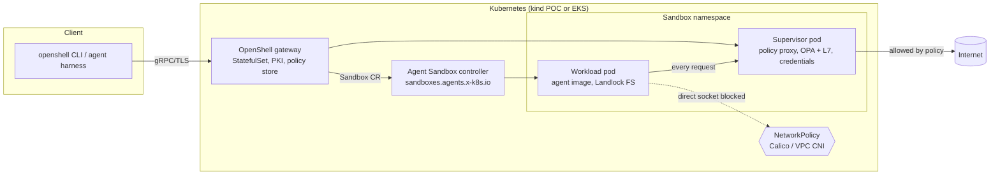

# openshell-eks-lab

> New here? Read [docs/GUIDE.md](docs/GUIDE.md) first: the whole project in plain words, every component, every flow, every command, and how logs and metrics get out. For tomorrow's EKS run, follow [docs/DEPLOYMENT.md](docs/DEPLOYMENT.md).

**Run untrusted AI agents on Kubernetes with NVIDIA OpenShell, and prove the sandbox holds.**

OpenShell puts every agent in a sandbox with a policy proxy in front of it. This repo turns that
into something you can stand behind in a security review:

1. **Policy as code.** Sandbox policies live in `policies/`, and `oslab lint` blocks risky rules
   (wildcard hosts, `access: full`, internal/metadata hosts, shell binaries, writable `/etc`)
   before they merge.
2. **A hostile-agent security suite.** 18 cases, each something a prompt-injected agent would try:
   exfiltrate over HTTPS or HTTP, hit cloud metadata, reach the Kubernetes API or the gateway,
   bypass the proxy with a raw socket, POST through a read-only host, reuse curl's rule from
   python, write to `/usr/bin` or `/etc`, find a service-account token or an API key, become root.
   Plus a live policy update with no restart.
3. **The same suite on two targets.** POC on kind (laptop or GitHub Actions) and enterprise on EKS
   (Terraform, TLS, OIDC, tainted sandbox nodes, VPC CNI NetworkPolicy), with create → test → destroy
   in one run.

Bible (visual walkthrough, end-to-end architecture diagram, checks, run commands): [`site/index.html`](site/index.html), deployed on Vercel from this repo and also a tab in the Study Bible.

## Architecture



The workload never holds a route to the internet. Its only path out is the supervisor, which checks
host, port, binary, HTTP method and path against the policy. NetworkPolicy closes the side door
(case NET-07 proves it is closed).

## Quick start (POC, about 10 minutes)

Needs Docker, kind, kubectl, helm, Python 3.11+.

```bash
make install        # oslab CLI + test deps
make test           # policy lint + unit tests, no cluster needed
make poc            # kind + Calico + Agent Sandbox + OpenShell (telemetry off)
make e2e            # security suite -> evals/results/<date>-kind/summary.md
make poc-down
```

Enterprise path: [`docs/ENTERPRISE.md`](docs/ENTERPRISE.md). In CI it is the `eks-e2e` workflow
(manual, behind the `eks` environment).

## What runs where

| Tier | Where | What it proves |
|---|---|---|
| Unit | every push (`ci`) | policy rules fire, runner scores and gates correctly, reports render |
| Manifests | every push (`ci`) | the pinned chart renders with both value sets; prod values never allow anonymous users; Terraform validates |
| POC e2e | every push + nightly (`e2e-kind`) | the 18 cases against a real gateway on kind with Calico |
| Enterprise e2e | on demand (`eks-e2e`) | the same 18 cases on EKS, then destroy |

## Pinned versions

`versions.env`: OpenShell v0.1.9, chart 0.1.9, Agent Sandbox v1.0.3, Calico v3.30.3. Every
third-party piece and why it is trusted: [`docs/SECURITY-VET.md`](docs/SECURITY-VET.md).
OpenShell sends anonymous telemetry by default; this repo turns it off everywhere.

## Scorecard (honest)

| Dimension | Score | Evidence | What closes the gap |
|---|---|---|---|
| Policy-as-code + lint | 10 | `app/oslab/policy_lint.py`, 18 parametrised rule tests | - |
| Security suite design | 9 | `evals/datasets/security-cases.yaml` (18 cases, 8 critical) | DNS-exfil and provider-credential cases (next) |
| Runner, gate, reports | 10 | `tests/unit/test_runner.py` (secure model passes, leaky model fails with named blockers) | - |
| POC e2e on kind | 10 | 18/18 pass, gate PASS, on a real gateway: [run 44689617405](https://github.com/sai337/openshell-eks-lab/actions/runs/44689617405) | - |
| EKS enterprise path | 7 | Terraform, values-eks, OIDC bootstrap, `eks-e2e.yml` | one `eks-e2e` run in your lab account |
| Docs, threat model, runbook | 9 | `docs/` | add measured numbers from the first runs to the blog draft |

Upstream status: NVIDIA marks the OpenShell Helm chart experimental and not for production.
The EKS path here is a hardened pilot, not a production claim.

## Docs

| Doc | What it covers |
|---|---|
| [docs/DEPLOYMENT.md](docs/DEPLOYMENT.md) | EKS end to end from a laptop or Kiro: provision, install, test, tear down |
| [docs/PROMOTION.md](docs/PROMOTION.md) | sbx → staging → canary → prod, gates G0–G5, the G2 policy-diff gate |
| [docs/EVALS.md](docs/EVALS.md) | how results are scored, results so far, how to add a case |
| [docs/TEST-CASES.md](docs/TEST-CASES.md) | every test case with its threat and pass rule |
| [docs/ARCHITECTURE.md](docs/ARCHITECTURE.md) · [THREAT-MODEL](docs/THREAT-MODEL.md) · [RUNBOOK](docs/RUNBOOK.md) · [SECURITY-VET](docs/SECURITY-VET.md) | design, threats, fixes, third-party vetting |
| [article/](article) | the write-up, LinkedIn copy and images |
| [.kiro/steering/project.md](.kiro/steering/project.md) | rules and definition of done for an agent running the deployment |

## Licence

Apache-2.0
