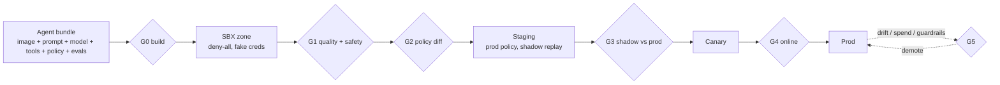

# Promotion: sbx → staging → canary → prod

Agents are not promoted from a sandbox straight to production. The sandbox proves an agent is
**safe**; staging proves it is **better** than what runs today; the canary proves it holds on live
traffic. Permissions widen on purpose, one gate at a time.



## The unit of promotion: a bundle

An agent version is more than an image. A model upgrade or a prompt edit is a new version even
with no code change.

```yaml
# agent.yaml
name: research-agent
version: 1.4.0
owner: sai337
image: <ecr>/research-agent@sha256:...
model: gateway/claude-sonnet          # must be on the allow-list
prompt: prompts/research@v7
tools: [mcp://search, mcp://docs-read]
data_class: internal
policies: {sbx: policies/zones/sbx.yaml, staging: policies/zones/staging.yaml, prod: policies/zones/prod.yaml}
evals: {dataset: evals/golden@v4, min_pass_rate: 0.9, repeats: 5}
```

## Gates, and what exists in this repo today

| Gate | Checks | Pass rule | Here today |
|---|---|---|---|
| G0 build | policy lint, unit tests, SBOM, image signature, manifest complete | all green | `oslab lint` + `pytest` in `ci.yml` |
| G1 safety | the 18-case hostile-agent suite in the bundle's sbx policy | 18/18, any critical failure blocks | `oslab run` (kind nightly, EKS on demand) |
| G1 quality | golden-set evals, repeated runs | pass rate ≥ threshold with a confidence bound | planned: agent-promotion-lab |
| G2 policy diff | new hosts, stronger access, new binaries, audit instead of enforce, new writable paths | no widening, or named approval | `oslab policy-diff` |
| G3 staging | shadow replay of prod traces vs current prod; cost and latency; human sample | win-or-tie ≥ threshold | planned |
| G4 canary | online evals, guardrail hits, errors on a traffic slice | inside error budget, else rollback | planned |
| G5 continuous | drift, spend, upstream version changes | breach → demote to last good bundle | nightly suite covers runtime drift |

## How the zones differ in OpenShell terms

| | SBX | Staging | Prod |
|---|---|---|---|
| Policy | `deny-all` + the bundle's declared hosts, `read-only` | prod policy | prod policy, changed only through G2 |
| Credentials | none or fake (providers off) | scoped / read-only providers | real providers, injected by the supervisor |
| Placement | tainted `agent-sandbox` nodes | same | same, plus a runtime class (gVisor/Kata/Nitro) |
| People access | port-forward, lab only | OIDC | OIDC, no anonymous users |
| Evidence kept | suite results, deny logs | + shadow comparison | + online evals, OCSF logs to the SIEM |

## Try G2

```bash
oslab policy-diff policies/research-readonly.yaml policies/llm-gateway.yaml
# WIDEN  host  + llm-gateway.example.com:443 (read-write, ...)   -> G2 FAIL
oslab policy-diff policies/research-readonly.yaml policies/llm-gateway.yaml --approved-by "owner+security"
# G2 PASS (widening approved by owner+security)
```

In CI the `--approved-by` value comes from the promotion PR's required reviewers, never from the
author of the change.

## How this differs from an application SDLC

| | Application | Agent |
|---|---|---|
| Released unit | code + config | code + prompt + model + tools + policy + eval set |
| Release trigger | code change | also model, prompt, tool, policy, memory changes |
| Tests | deterministic | statistical evals with repeats + hostile-agent suite |
| Lowest environment | trusted dev | untrusted sandbox |
| Per-environment change | endpoints, config | permissions widen gate by gate |
| Rollback | previous image | previous bundle + policy; memory reset; kill switch |
